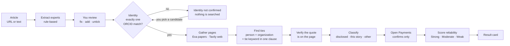
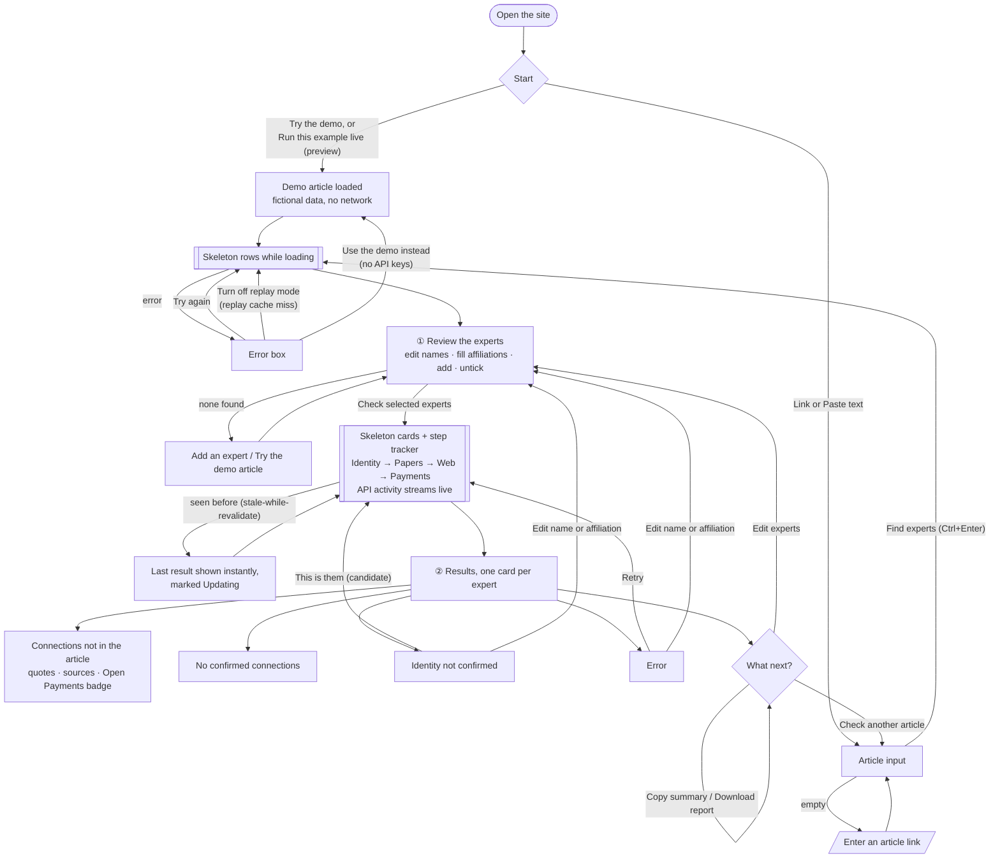
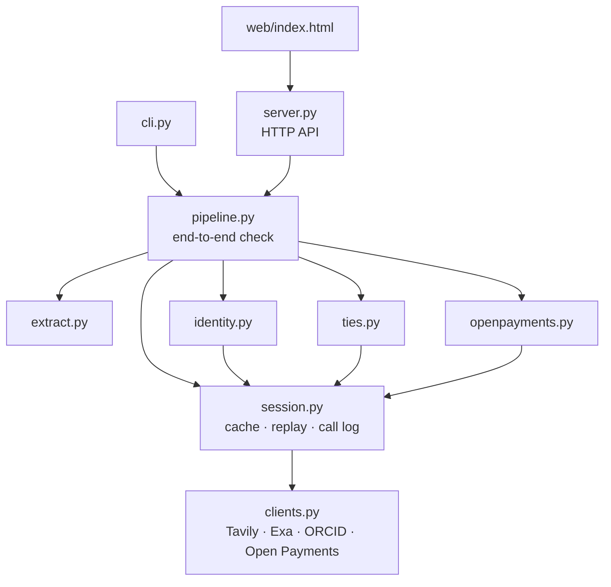

# Hack1984 · Conflict Check

**Who pays the experts an article quotes.** Paste a health news article. For each quoted expert, Conflict Check confirms who they are, then searches papers and the web for funding, consulting and board ties *the article didn't mention*, quoting the source for every one.

Surge track (Tavily + Exa). Scope: health news, where research papers carry conflict-of-interest statements.

**Contents:** [Quick start](#quick-start) · [How it works](#how-it-works) · [Using the app](#using-the-app) · [Reliability](#reliability-ratings) · [Safety rules](#safety-rules-from-the-risk-review) · [Demo](#demo) · [Reference](#reference) · [Project layout](#project-layout)

## Quick start

Python 3.10+, no third-party packages.

```sh
cp .env.example .env              # add TAVILY_API_KEY and EXA_API_KEY
python -m conflict_check.server   # http://localhost:8000
python -m unittest                # offline tests (fictional fixtures)
python tests/e2e/walk.py          # browser walk-through (needs Edge/Chrome and a running server)
```

ORCID, OpenAlex, the NPI registry and CMS Open Payments are free public APIs and need no key. No keys at all? Click **Try the demo** in the app.

## How it works



| Step | Module | API |
|---|---|---|
| Load the article (URL or pasted text) | `pipeline.load_article` | Tavily extract |
| Pull out quoted experts, their role and affiliation | `extract.py` | none, rule-based |
| Confirm identity: exactly one ORCID record for name + affiliation; else, if exactly one name match's papers list that institution, OpenAlex confirms it; or a user pick re-checked against the surname | `identity.py` | ORCID public API, OpenAlex |
| Find evidence pages: research papers (conflict statements) and web bios | `pipeline.gather_pages` | Exa research-paper search, Tavily search + extract |
| Extract ties: a clause naming the person, an organization and a tie keyword | `ties.find_ties` | none, rule-based |
| Classify: disclosed in the article / related to this story / other | `ties.classify_tie` | none |
| Confirmation badge: payments from that company to a clinician with that name | `openpayments.py` | CMS Open Payments |

Every call goes through `session.Session`, which caches each response to disk (keyed by request; keys are never stored), supports replay mode, and reports each call to the UI as it happens.

## Using the app

1. **Find experts.** Paste an article URL (fetched with Tavily extract) or its text.
2. **Review the list.** Fix names, fill in missing affiliations, untick anyone who isn't an expert, or add someone the extractor missed. Up to 5 are checked. The affiliation matters: it's what identity is confirmed against.
3. **Check.** Results stream in one expert at a time, and every Tavily, Exa, ORCID and Open Payments call appears in the **API calls** panel as it happens.
4. **Pick the right person if asked.** If ORCID can't confirm the expert on its own, the card lists candidate records. Click **This is them** to re-run that expert. The picked ORCID iD is re-checked against the expert's surname.

Each card is a short list: one row per company with its type of connection, a trust label (Strong, Moderate, Weak) and one line of evidence. The 5 strongest show first (named-in-the-story ones lead); the rest, including weak matches, are behind **Show the other N**. Select a row for every quote, the Open Payments detail and why it scored that way. The API call log sits below the results and folds away when the check finishes. Replay mode lives under **Advanced** on the form.

Each expert ends in one of these states:

| Status | Meaning |
|---|---|
| N connections not in the article | Verified ties found. Ties to companies named in the story are shown first under **Not in the article**; ties to other companies are behind "Show N more", and ties the article already mentioned are in a separate collapsed section. |
| No confirmed connections | Identity confirmed, nothing found. A normal result. |
| Identity not confirmed | ORCID didn't return exactly one match. No search is run and no ties are shown. |
| Error | The evidence search failed (e.g. a missing key or a replay-mode cache miss). The identity result is still shown. |

**Mask names** replaces each expert's name with "Expert A", "Expert B" and so on everywhere on the page. Use it on stage.

<details>
<summary><b>Site flow</b> (every state has a way forward)</summary>

Errors offer **Try again** plus a context-specific fix, and finished results offer next actions.



</details>

The **How it works** cards expand to full width with a view transition (click, **Close** or **Esc**). **Limits** is a separate section, and the nav underlines the section in view.

## Command line

Faster than the UI for tuning on real articles:

```sh
python -m conflict_check.cli https://example.com/article --experts-only   # check extraction only
python -m conflict_check.cli https://example.com/article                  # full check
python -m conflict_check.cli --file article.txt --expert "Jane Doe@Harvard Medical School" --json out.json
```

## Reliability ratings

The risk review scored the idea's reliability 2/5 because each expert goes through many steps that can fail. So every result shows how much to trust it, and why. The rules live in `conflict_check/reliability.py`.

**Per connection (0–100).** 100 × the weighted mean of seven factors, plus a bonus, clamped to 0–100 and rounded half-up:

| Factor | Weight | Values |
|---|---|---|
| Identity | 20% | confirmed by ORCID 1.0 · picked by a person 0.8 · unknown 0.5 |
| Attribution | 20% | best evidence named the person by full name 1.0 · surname 0.85 · initials 0.75 · semicolon continuation 0.7 · he/she 0.6 |
| Source | 20% | research-paper disclosure 1.0 · institutional page (.edu, .gov, .ac.xx) 0.85 · other web page 0.6 |
| Corroboration | 15% | independent websites: 1 → 0.55 · 2 → 0.85 · 3+ → 1.0 (pages on one site count once) |
| Wording | 10% | employment, equity, board, founder, patents 1.0 · consulting, advisory, research funding, speaking 0.9 · personal fees 0.75 · other 0.6 |
| Recency | 10% | newest year in the evidence: ≤3 years 1.0 (disclosures usually cover 36 months) · ≤6 years 0.75 · older 0.5 · none found 0.7 |
| Organization | 5% | full name 1.0 · bare acronym 0.8 |
| Open Payments | bonus | +8 when one physician's payments from that company match; never negative |

**Labels:** Strong 80+, Moderate 60–79, Weak below 60. The score is rounded before labelling, and a score exactly on a boundary takes the higher label (79.5 → 80 → Strong).

**What happens on a tie.** Connections are ordered by these rules, in turn:
1. Named in this story.
2. Higher score.
3. More independent websites.
4. Better best source.
5. More serious kind of tie (employment > equity > board > … > personal fees).
6. Organization name, A–Z, ignoring case.
7. The order they were found.

The order is fully deterministic.

**Coverage (per expert).** How thorough the search was, based on identity, pages checked and which search channels returned pages. It matters most for a clean "no confirmed connections" result: thin coverage makes that weak evidence. It isn't rated when identity wasn't confirmed or the search failed.

In the UI, each connection shows a pill (for example "Strong · 92"), and **Why 92?** lists every factor with a bar and a plain-language note.

## Safety rules (from the risk review)

- **No identity, no ties.** Identity needs exactly one ORCID match for name + affiliation, or exactly one name match whose papers list that institution (OpenAlex). Otherwise nothing is searched until a person picks the right record.
- **No model states a tie.** A tie appears only if a fetched page has a clause naming both the person and the organization, and `verify_quote` confirms the quote is on that page.
- **Open Payments only confirms.** It never creates a tie, because it matches on name and city, not employer. The badge shows location and NPI so a person can judge, and it's withheld if more than one clinician with that name was paid by the company.
- **Declining is a valid result.** "No confirmed connections" and "Identity not confirmed" are normal outcomes.
- **The wording is "connections the article didn't mention",** never "undisclosed conflicts" or "hidden ties".
- **On stage:** mask names, demo only hand-checked articles, and include one control article that should find nothing.

## Demo

**Built-in demo:** click **Try the demo** in the check card, or **Run this example live** under the product preview. It runs the real pipeline on a fictional article, people and companies, with realistic delays and no keys or network. It covers every result state: a confirmed expert with ties and an Open Payments badge, an expert you confirm by picking a candidate, and a spokesperson who is set aside.

**Replaying real runs:** every live response is cached, so a run you've done once can be replayed with no network:

```sh
python -m conflict_check.server --cache-dir demo-cache        # run the demo articles live once
python -m conflict_check.server --cache-dir demo-cache --replay   # on stage
```

`cache/` is git-ignored. To share a demo cache with the team, use a separate folder such as `demo-cache/` and commit it. In replay mode, an uncached request shows as a red **miss** in the API panel.

The walk-through script is in [DEMO.md](DEMO.md). `demo-cache/` holds every API response for two real articles, so the demo runs offline.

## Reference

### HTTP API

| Route | Body | Returns |
|---|---|---|
| `POST /api/experts` | `{url \| text, replay?, demo?}` | article text and extracted experts |
| `POST /api/check` | `{url \| text, experts?, replay?, demo?}` | the full result as JSON |
| `POST /api/check/stream` | same | NDJSON events: `start`, `call`, `expert`, then `done` or `error` |
| `GET /api/config` | | replay default, cache folder, which keys are set (`stale-while-revalidate`) |
| `GET /api/demo` | | the fictional demo article |

`experts` is a list of `{name, affiliation?, orcid?}`. Leave it out to use the extractor's top 5. `"demo": true` runs the real pipeline on fictional data from `conflict_check/demo.py`, with no keys and no network. Requests over 2 MB are rejected.

**Caching.** The page is sent with `no-cache`, so a demo laptop never shows a stale UI. `/api/config` uses `stale-while-revalidate`. In the browser, a repeat check of the same article and experts shows the last result immediately, marked **Updating**, while fresh results stream in. The last 8 checks are kept in local storage.

### Configuration

| Variable | Default | Purpose |
|---|---|---|
| `TAVILY_API_KEY`, `EXA_API_KEY` | | Required for live runs |
| `CACHE_DIR` | `cache` | Response cache folder (same as `--cache-dir`) |
| `OPEN_PAYMENTS` | on | Set to `off` to skip the badges |
| `OPEN_PAYMENTS_DATASETS` | 2025 and 2024 | `year:dataset-id,…` from the CMS metastore |

### Evaluation

```sh
python -m eval.run_eval [--replay]
```

Scores `eval/testset.json`: each case is an article plus, for each expert, the undisclosed ties a person confirmed by hand (`[]` means it should find nothing). An expert can be `{"affiliation": "...", "ties": [...]}`, because identity is confirmed against the affiliation. Reports precision, recall and how often the tool declines.

The set holds 15 experts across 10 real articles, plus one fictional placeholder. The labels list ties found on disclosure pages (re-checked against PMC full text or the MSK profile page), not every real tie, so precision is a floor: ties the tool finds that nobody labelled count as false positives. It has one negative case. Last live run: recall 66%, precision 23%, 9 of 18 experts declined at the ORCID step. To grow it, add articles with at least one expert whose disclosures you have read in full. For the slide, cite Wang, Grey and Bolland, CMAJ 2017 (PMC5392116): about a third of commenters had financial conflicts, and two-thirds of those went unreported.

### Cost

A 5-expert check costs about 5-7 Tavily credits and $0.03 of Exa. Identity is checked first, so unconfirmed experts cost nothing. Each confirmed expert runs two Exa searches (disclosure wording, and recent papers that contain the name) and one advanced-depth Tavily search. Failed calls retry twice on 429 and 5xx errors; Open Payments lookups give up after 20 s.

### Design system

The UI is one page (`web/index.html`) built from a small set of tokens defined on `:root`. Components only use these, so spacing, type and shape stay consistent.

| Token group | Values |
|---|---|
| Type (`--fs-*`) | 2xs 11 · xs 12 · sm 14 · base 16 · md 18 · lg 22 · xl clamp(26–34) · display clamp(36–64) px |
| Spacing (`--sp-1…8`) | 4 · 8 · 12 · 16 · 24 · 32 · 48 · 72 px |
| Radius (`--r-*`) | xs 6 · sm 12 · md 18 · lg 24 · pill; squircle (`corner-shape`) where supported |
| Motion | `--dur-fast` .15s · `--dur` .2s · `--ease`; everything stops under reduced motion |
| Color | semantic tokens (`--ink`, `--surface`, `--accent`, `--flag`, `--ok`, `--warn`, …) redefined for dark mode |

**Rules the page follows:**
- **Icons:** one SVG set (`#i-*` symbols): 24px grid, 2px round strokes, `currentColor`. No text glyphs as icons.
- **Fonts:** Unbounded for display, the system UI font for text. Monospace (Space Mono) is only for code-like text: API query labels, keys, code samples.
- **No filler:** no decorative badges or labels that repeat what the layout already says. Status chips, tie categories and reliability pills carry information.
- **Optical alignment:**
  - the display headline is pulled back by its side bearing to line up with the text
  - opening quote marks hang
  - circles are drawn about 6% larger than squares
  - icons and numerals are nudged to their visual centre
  - buttons trim to cap height where `text-box` is supported
- **Headlines** use `text-wrap: balance` and body text uses `pretty`. The hero headline is two unbreakable phrases, so it's one line or "Who pays / the experts?", never split mid-phrase.
- **Loading:** any button whose action takes time shows a spinner, a shine sweep and `aria-busy` until it settles. Content that's loading shows skeletons.

The hero puts the main feature first (the check itself, enlarged) beside a live-styled **product preview**, built from the same components as real results, with fictional data. Its **Run this example live** button runs the demo.

## Project layout



```
conflict_check/   the package: the modules above, plus reliability.py and demo.py
web/index.html    the UI
tests/            offline tests with fictional fixtures
eval/             test set and scoring script
```

## Still to do

- [ ] Grow the test set to ~20 articles with more negative cases, and put precision, recall and decline rate on one slide.
- [x] Curated `demo-cache/` and demo script ([DEMO.md](DEMO.md)).
- [ ] Backup video and a limitations slide.
- [ ] Optional: an AI extractor for experts as a fallback when the rules miss someone; its output would still go through the review step.
