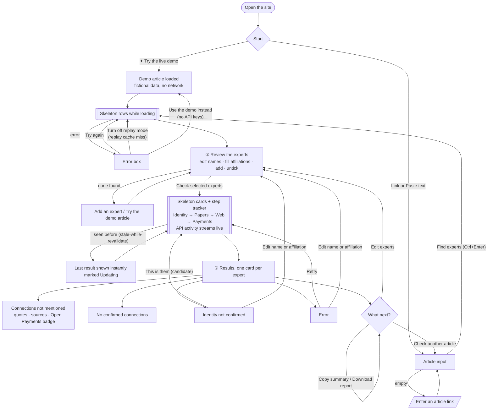

# Hack1984 · Conflict Check

**Who pays the experts an article quotes.** Paste a health news article. For each quoted expert, Conflict Check confirms who they are, then searches papers and the web for funding, consulting and board ties *the article didn't mention*, quoting the source for every one.

Surge track (Tavily + Exa). Scope: health news, where research papers carry conflict-of-interest statements.

## Quick start

Python 3.10+, no third-party packages.

```sh
cp .env.example .env              # add TAVILY_API_KEY and EXA_API_KEY
python -m conflict_check.server   # http://localhost:8000
python -m unittest                # 12 offline tests (fictional fixtures)
```

ORCID and CMS Open Payments are free public APIs and need no key.

## Using the app

1. **Find experts.** Paste an article URL (fetched with Tavily extract) or its text.
2. **Review the list.** Fix names, fill in missing affiliations, untick anyone who isn't an expert, or add someone the extractor missed. Up to 5 are checked. The affiliation matters: it's what identity is confirmed against.
3. **Check.** Results stream in one expert at a time, and every Tavily, Exa, ORCID and Open Payments call appears in the **API calls** panel as it happens.
4. **Pick the right person if asked.** If ORCID can't confirm the expert on its own, the card lists candidate records. Click **This is them** to re-run that expert. The picked ORCID iD is re-checked against the expert's surname.

Each expert ends in one of these states:

| Status | Meaning |
|---|---|
| Connections the article didn't mention | Verified ties found. Ties to companies named in the story come first; others and ones the article disclosed are collapsed. |
| No confirmed connections | Identity confirmed, nothing found. A normal result. |
| Identity not confirmed | ORCID didn't return exactly one match. No search is run and no ties are shown. |
| Error | The evidence search failed (e.g. a missing key or a replay-mode cache miss). The identity result is still shown. |

**Mask names** replaces each expert's name with "Expert A", "Expert B" and so on everywhere on the page. Use it on stage.

### Site flow

Every state has a way forward: errors offer **Try again** plus a context-specific fix, and finished results offer next actions.



The **How it works** cards expand to full width with a view transition (click, **Close** or **Esc**). **Limits** is a separate section, and the nav underlines the section in view.

## Command line

Faster than the UI for tuning on real articles:

```sh
python -m conflict_check.cli https://example.com/article --experts-only   # check extraction only
python -m conflict_check.cli https://example.com/article                  # full check
python -m conflict_check.cli --file article.txt --expert "Jane Doe@Harvard Medical School" --json out.json
```

## How it works

| Step | Module | API |
|---|---|---|
| Load the article (URL or pasted text) | `pipeline.load_article` | Tavily extract |
| Pull out quoted experts, their role and affiliation | `extract.py` | none, rule-based |
| Confirm identity: exactly one ORCID record for name + affiliation, or a user pick re-checked against the surname | `identity.py` | ORCID public API |
| Find evidence pages: research papers (conflict statements) and web bios | `pipeline.gather_pages` | Exa research-paper search, Tavily search + extract |
| Extract ties: a clause naming the person, an organization and a tie keyword | `ties.find_ties` | none, rule-based |
| Classify: disclosed in the article / related to this story / other | `ties.classify_tie` | none |
| Confirmation badge: payments from that company to a physician with that name | `openpayments.py` | CMS Open Payments |

Every call goes through `session.Session`, which caches each response to disk (keyed by request; keys are never stored), supports replay mode, and reports each call to the UI as it happens.

### HTTP API

| Route | Body | Returns |
|---|---|---|
| `POST /api/experts` | `{url \| text, replay?, demo?}` | article text and extracted experts |
| `POST /api/check` | `{url \| text, experts?, replay?, demo?}` | the full result as JSON |
| `POST /api/check/stream` | same | NDJSON events: `start`, `call`, `expert`, then `done` or `error` |
| `GET /api/config` | | replay default, cache folder, which keys are set (`stale-while-revalidate`) |
| `GET /api/demo` | | the fictional demo article |

`experts` is a list of `{name, affiliation?, orcid?}`. Leave it out to use the extractor's top 5. `"demo": true` runs the real pipeline on fictional data from `conflict_check/demo.py`, with no keys and no network. Requests over 2 MB are rejected.

**Caching.** The page is sent with `no-cache`, so a demo laptop never shows a stale UI. `/api/config` uses `stale-while-revalidate`. In the browser, a repeat check of the same article and experts shows the last result immediately, marked **Updating**, while fresh results stream in. The last 8 checks are kept in local storage.

## Safety rules (from the risk review)

- **No identity, no ties.** If ORCID doesn't return exactly one match for name + affiliation, nothing is searched until a person picks the right record.
- **No model states a tie.** A tie appears only if a fetched page has a clause naming both the person and the organization, and `verify_quote` confirms the quote is on that page.
- **Open Payments only confirms.** It never creates a tie, because it matches on name and city, not employer. The badge shows location and NPI so a person can judge, and it's withheld if more than one physician with that name was paid by the company.
- **Declining is a valid result.** "No confirmed connections" and "Identity not confirmed" are normal outcomes.
- **The wording is "connections the article didn't mention",** never "undisclosed conflicts" or "hidden ties".
- **On stage:** mask names, demo only hand-checked articles, and include one control article that should find nothing.

## Demo mode

**Built-in demo:** click **✦ Try the live demo**. It runs the real pipeline on a fictional article, people and companies, with realistic delays and no keys or network. It covers every result state: a confirmed expert with ties and an Open Payments badge, an expert you confirm by picking a candidate, and a spokesperson who is set aside.

**Replaying real runs:** every live response is cached, so a run you've done once can be replayed with no network:

```sh
python -m conflict_check.server --cache-dir demo-cache        # run the demo articles live once
python -m conflict_check.server --cache-dir demo-cache --replay   # on stage
```

`cache/` is git-ignored. To share a demo cache with the team, use a separate folder such as `demo-cache/` and commit it. In replay mode, an uncached request shows as a red **miss** in the API panel.

## Configuration

| Variable | Default | Purpose |
|---|---|---|
| `TAVILY_API_KEY`, `EXA_API_KEY` | | Required for live runs |
| `CACHE_DIR` | `cache` | Response cache folder (same as `--cache-dir`) |
| `OPEN_PAYMENTS` | on | Set to `off` to skip the badges |
| `OPEN_PAYMENTS_DATASETS` | 2025 and 2024 | `year:dataset-id,…` from the CMS metastore |

## Evaluation

```sh
python -m eval.run_eval [--replay]
```

Scores `eval/testset.json`: each case is an article plus, for each expert, the undisclosed ties a person confirmed by hand (`[]` means it should find nothing). Reports precision, recall and how often the tool declines. The set currently holds one fictional placeholder; it needs about 20 real health-news articles, checked with the CMAJ 2017 method (compare quoted experts against their own paper disclosures). For the slide, cite Wang, Grey and Bolland, CMAJ 2017 (PMC5392116): about a third of commenters had financial conflicts, and two-thirds of those went unreported.

## Project layout

```
conflict_check/
  session.py       cache, replay mode, call log and live call hook
  clients.py       Tavily, Exa, ORCID and Open Payments clients
  extract.py       quoted experts from article text
  identity.py      ORCID identity confirmation and user picks
  ties.py          tie extraction, quote verification, classification
  openpayments.py  Open Payments confirmation badge
  pipeline.py      the end-to-end check
  server.py        web server and HTTP API
  cli.py           command-line runner
web/index.html     the UI
tests/             offline tests with fictional fixtures
eval/              test set and scoring script
```

## Still to do

- [ ] Hour-1 test: run 3–5 real health articles with the CLI; tune the patterns in `extract.py` and `ties.py`.
- [ ] Build the ~20-article test set and put precision and decline rate on one slide.
- [ ] Record the demo: curated `demo-cache/`, backup video, limitations slide.
- [ ] Optional: an AI extractor for experts as a fallback when the rules miss someone; its output would still go through the review step.
